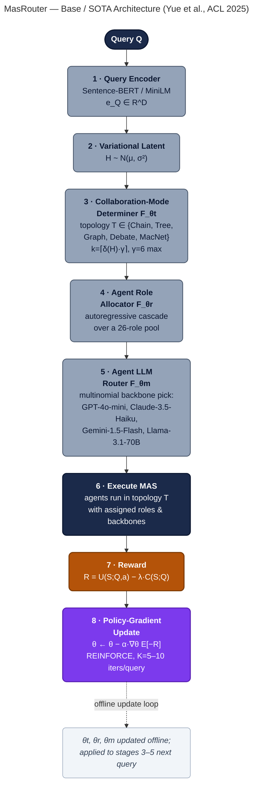
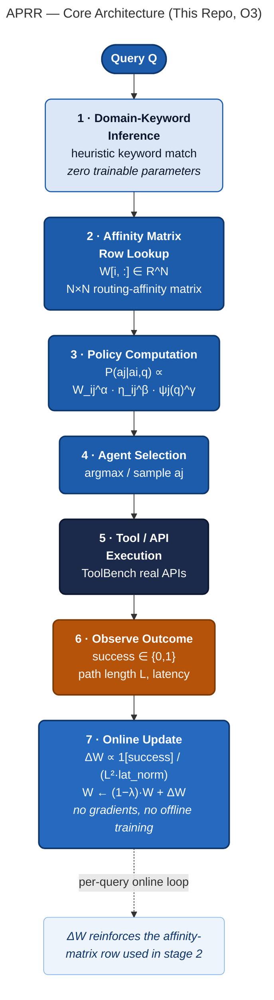
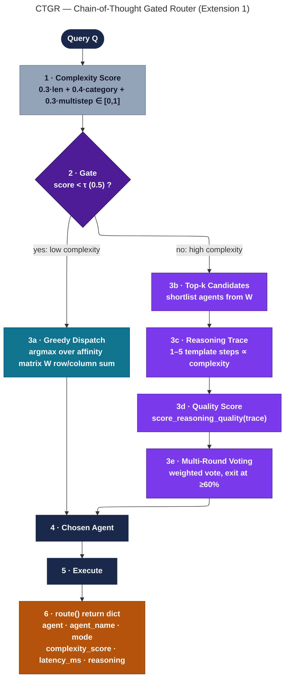
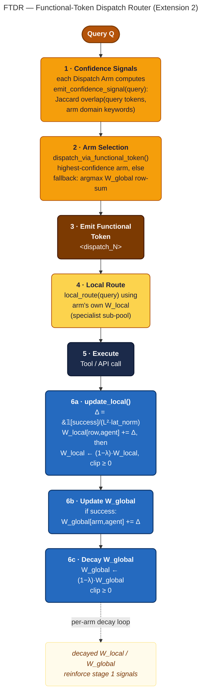

# APRR: Adaptive Probabilistic Routing Reinforcement (ACRS objective O3: risk-weighted policy routing)

> **Ph.D. CSE, M S Ramaiah University of Applied Sciences (FET).**  
> Scholar: Jenisha T (`24ETRP720001`). Supervisor: Dr. Padma Priya Dharishini P.  
> ACRS objectives in the order they act: O1 session-adaptive tool scoring (SATR) → O2 PID-controlled provenance pruning (FCNP) → **O3 risk-weighted policy routing (APRR)** → O4 certified execution (MNCD), with G1 policy as code.

**Objective numbering.** The thesis numbers the objectives in the order in which they act within one step. Older sections of this README, the notebooks and the Hugging Face Space call this work "Objective 2"; in the thesis it is **O3**.

## Latest: ACRS on AppWorld (November 2026)

APRR now runs inside ACRS as O3 and is evaluated on [AppWorld](https://github.com/StonyBrookNLP/appworld) (Trivedi et al., ACL 2024: 9 apps, 457 APIs, tasks graded by state-based unit tests) with open-weight models: Qwen3-8B (AWQ 4-bit) as the large tier and Qwen3-4B (AWQ 4-bit) as the small tier, served with vLLM on two free T4 GPUs.

**What O3 does on AppWorld.** Before each step, a two-arm contextual Thompson sampler (a Beta posterior per arm and context) picks the 4B or the 8B model. The context records whether the last step failed, whether the APIs that O1 retrieves for the task include a state-changing call, whether O2 had to cut an output that no live variable still holds, and whether the episode is late (step 15 or later). In a risky context (any of the first three), the 4B model must beat the 8B model by a margin δ = 0.35; the 8B model carries a cost penalty λ = 0.15. The reward is 1 when the step ran without error, G1 allowed it and, if it changed state, O4 committed it.

**Development split, first full run** (57 tasks in 19 scenarios, one seed, three worked examples; Kaggle on 2 × T4: seven configurations in 10 h 32 min, the run without O3 in a second session of 131 min). Aggregates only: AppWorld task text and API outputs are not published.

| Configuration | Task success (TGC) | Scenarios (SGC) | Steps / task | Tokens (M) | Steps on the 8B model | Collateral damage |
|---|---|---|---|---|---|---|
| Reference agent (8B on every step, no ACRS part) | 19.3 % (11/57) | 1/19 | 15.3 | 3.39 | 100 % (873) | 0/57 |
| **Full ACRS** | **17.5 % (10/57)** | **3/19** | **10.1** | **3.36** | **78.2 % (448; 125 on the 4B)** | **0/57** |
| O2 only | 15.8 % (9/57) | 1/19 | 13.9 | 2.22 | 100 % | 0/57 |
| Full without O1 | 10.5 % (6/57) | 0/19 | 7.6 | 2.48 | 75.0 % | 0/57 |
| Full without O2 | 19.3 % (11/57) | 2/19 | 10.6 | 4.16 | 77.3 % | 0/57 |
| Full without O3 | 14.0 % (8/57) | 1/19 | 10.0 | 3.14 | 100 % (570) | 0/57 |
| Full without O4 | 14.0 % (8/57) | 0/19 | 7.7 | 1.38 | 80.3 % | 1/57 |
| Full without G1 | 12.3 % (7/57) | 0/19 | 11.0 | 3.57 | 80.9 % | 0/57 |

What the run supports for O3 (RQ3):

- 21.8 % of full-ACRS steps were written by the 4B model. Full ACRS called the 8B model 448 times, against 570 for the same system without O3 (21 % fewer) and 873 for the reference agent (49 % fewer; its episodes were also longer). Total tokens were similar with and without O3 (3.36 M and 3.14 M), because the 4B model's steps also cost tokens.
- Task success did not differ significantly: 17.5 % with O3 against 14.0 % without it (2 tasks against 0, McNemar exact p = 0.5), and against 19.3 % for the reference agent (7 tasks against 8, p = 1.0).
- Status: the cost claim is supported; the risk-signed part (risky steps go to the 8B model) waits for a check of the per-step logs.

No configuration differs significantly in task success on 57 tasks (every McNemar p ≥ 0.34); about 155 paired tasks are needed to detect a 10-point difference, so the test splits will be run with three seeds. The released harness uses the earlier numbering in its configuration names (`no_o2` is the run without O3).

- Code: [joyjeni/acrs-appworld, branch `o4-provenance`](https://github.com/joyjeni/acrs-appworld/tree/o4-provenance)
- Dashboard: **https://aprr-multi-agent-routing.vercel.app** (AppWorld first, then the earlier results)
- Aggregate data: [`vercel-app/public/data/appworld_dev.json`](vercel-app/public/data/appworld_dev.json)

## Earlier work: APRR on a simulated ToolBench workflow (June to October 2026)

The rest of this README documents APRR as it was developed before AppWorld, with simulated agents over ToolBench queries.

This repository is the **routing chapter** of ACRS: a training-free posterior over
**tool-specialist agents**, updated from SATR scores and live MNCD observations.
The unit of a journal paper is the Bayesian / affinity controller, **not** a
Pareto chart.

**Proposal-stage stance:** latency, hop-count, success-rate, and “Pareto frontier”
figures that may appear in notebooks or older README revisions are **not**
commitments of the research proposal. They are laboratory traces pending a
frozen, multi-seed bake-off against the papers named below.

**Author:** Jenisha T, MS Ramaiah University of Applied Sciences — Ph.D. candidate, Computer Science Engineering.

---

## Base Paper & Design Architecture (Objective 2)

> This section exists specifically to make the PhD-defense positioning explicit and auditable: which published SOTA architecture this work is measured against, exactly what is kept vs. cut vs. changed, and why. All citations below are independently verified (title, authors, venue, year, and URL/DOI checked against the publisher) — no placeholder or unverifiable citations are used anywhere in this repository.

### Base / SOTA architecture

**MasRouter** — Yue, Y., Zhang, G., Liu, B., Wan, G., Wang, K., Cheng, D., & Qi, Y. (2025). *MasRouter: Learning to Route LLMs for Multi-Agent Systems.* Proceedings of the 63rd Annual Meeting of the Association for Computational Linguistics (ACL 2025), Volume 1: Long Papers, pp. 15549–15572. DOI: [10.18653/v1/2025.acl-long.757](https://doi.org/10.18653/v1/2025.acl-long.757) · [aclanthology.org/2025.acl-long.757](https://aclanthology.org/2025.acl-long.757/)

MasRouter is the closest verified, published SOTA architecture for the exact problem class this repo addresses ("which agent(s) should handle this query" in a multi-agent LLM system), and it is already used as a related-work comparison point in `paper/manuscript.md`. It is a cascaded, end-to-end trained neural controller with three sub-networks:

1. **Collaboration-mode determiner** \(F_{\theta_t}: Q \to T\) — a variational-latent model (Sentence-BERT/MiniLM query encoder + learned fusion network) that samples a topology \(T\) (Chain, Tree, Complete Graph, Debate, MacNet, …) and the number of agents \(k=\lceil\delta(H)\cdot\gamma\rceil\) (\(\gamma{=}6\) max).
2. **Agent role allocator** \(F_{\theta_r}: (Q,T) \to \{R_i\}_{i=1}^k\) — an autoregressive cascade assigning each of up to 6 agents one of 26 predefined roles (e.g. MathAnalyst, BugFixer, Critic).
3. **Agent LLM router** \(F_{\theta_m}: (Q,T,\{R_i\}) \to \{M_i\}_{i=1}^k\) — a multinomial-distribution model assigning each agent an LLM backbone from a pool of 4–5 models (GPT-4o-mini, Claude-3.5-Haiku, Gemini-1.5-Flash, Llama-3.1-70B, ± DeepSeek-V3).

All three sub-networks are trained jointly via **policy-gradient optimisation** (REINFORCE; Williams, 1992) on the reward \(R = U(S;Q,a) - \lambda\cdot C(S;Q)\) (utility minus a cost penalty), evaluated on MMLU, GSM8K, MATH, HumanEval, and MBPP — general reasoning and code tasks, **not** tool-calling/API selection.

Two further verified reference points inform the comparison:
- **RouteLLM** — Ong, I., Almahairi, A., Wu, V., Chiang, W.-L., Wu, T., Gonzalez, J.E., Kadous, M.W., & Stoica, I. (2024). *RouteLLM: Learning to Route LLMs with Preference Data.* arXiv:[2406.18665](https://arxiv.org/abs/2406.18665). The single-model-routing precursor MasRouter itself benchmarks against; routes between exactly 2 candidate LLMs, no multi-agent topology.
- **DyTopo** — Lu, Y., Hu, Y., Zhao, X., & Cao, J. (2026). *DyTopo: Dynamic Topology Routing for Multi-Agent Reasoning via Semantic Matching.* arXiv:[2602.06039](https://arxiv.org/abs/2602.06039). Contemporaneous work on per-round dynamic agent-graph routing; conceptually closest to APRR's per-hop routing but still uses a learned semantic-matching network rather than a training-free affinity update.

### What changes in this repo (APRR) — cut from the SOTA architecture

| # | Cut / change from MasRouter | Why |
|---|---|---|
| 1 | **Removed** the agent-LLM-routing stage \(F_{\theta_m}\) (no "which LLM backbone" decision) | This repo's setting is routing over a **fixed pool of specialist tool-agents** (one per ToolBench API category), not swapping interchangeable general-purpose LLM backbones. |
| 2 | **Removed** the role-allocation stage \(F_{\theta_r}\) and its 26-role pool | Tool-agents here have fixed, predefined responsibilities; there is no dynamic "assign a role" decision to make. |
| 3 | **Removed** the text-encoder + variational-latent + fusion network (Sentence-BERT/MiniLM, Gaussian latent \(H\), FFN fusion \(g_\phi\)) | APRR has **zero trainable parameters**. It updates a plain \(N\times N\) affinity matrix \(W\) with a closed-form rule instead of a learned embedding pipeline. |
| 4 | **Removed** the policy-gradient training loop (REINFORCE, \(\alpha{=}0.01\), \(K{=}5\text{--}10\) iterations per query, offline oracle-answer supervision) | Replaced with an **online, non-parametric** update rule (\(\Delta W \propto \mathbb{1}[\text{success}]\cdot 1/L^2 \cdot 1/\text{latency\_norm}\), multiplicative decay \((1-\lambda)\)) that updates after a single observed interaction — no gradients, no offline training data. |
| 5 | **Kept** the reward-driven, cost-aware optimisation *principle* | MasRouter's \(\lambda\cdot C(S;Q)\) cost penalty and APRR's \(1/\text{latency\_norm}\) term both penalise expensive routes; both cite Williams (1992) REINFORCE as the underlying theoretical grounding (APRR's Proposition 1 states the specific conditions — \(\alpha{=}\gamma{=}1,\beta{=}\lambda{=}0\) — under which its update is REINFORCE-equivalent). |
| 6 | **Changed evaluation domain** | From general reasoning/code (MMLU/GSM8K/MATH/HumanEval/MBPP) to real tool-calling **API selection** on ToolBench (Qin et al., ICLR 2024) — a setting neither MasRouter nor RouteLLM evaluates on. |

### Design architecture diagrams

Four separate, detailed diagrams — one per distinct flow — so each is readable at full detail (GitHub renders Mermaid natively; no external tool needed to view these).

> **Rendering note (fixed 2026-08-17):** the previous revision of these four diagrams used a 2-row `subgraph`-wrapped layout with the default Mermaid/dagre renderer. When an edge crossed a subgraph boundary whose internal `direction` differed from the parent flowchart's direction, dagre routed that edge to the subgraph's *cluster* boundary rather than all the way to the actual target node — on a few edges (the `Query Q → stage 1` entry edge, the row-1→row-2 handoff edge, and the CTGR gate branches) this left a visible gap between the arrowhead and the node it was supposed to point at. All four diagrams below were rebuilt on the [ELK layout engine](https://github.com/kieler/elkjs) (`config: {layout: elk}`), which routes every edge — including ones crossing branch/merge points — all the way to the node's actual border. The trade-off: ELK does not honor a `direction` override inside a subgraph, so the earlier compact 2-row grid is no longer possible; these are now single-direction top-to-bottom pipelines (and a top-to-bottom decision tree for CTGR) rather than a wide 2×4 grid. Source `.mmd` + rendered `.png` for both the corrected version and the original are kept in the repo (see [Source files](#design-architecture-source-files) below) so the change is auditable.

#### 1. Base / SOTA — MasRouter (Yue et al., ACL 2025)



Gray = stages **cut** in APRR. Navy = execution. Amber = reward. Purple = the policy-gradient training loop APRR does not have.

#### 2. This repo — APRR core routing loop



APRR replaces MasRouter's entire learned-encoder + 3-network cascade with a single closed-form affinity-matrix lookup and update — zero trainable parameters, no gradients.

#### 3. Extension 1 — CTGR (Chain-of-Thought Gated Router)



CTGR re-adds MasRouter's "give complex queries more deliberation" idea as a training-free gate: below the complexity threshold it falls back to plain APRR greedy dispatch (`route()` → `mode="greedy"`); above it, `deliberate()` runs template reasoning traces and multi-round weighted voting with early-exit at a 60% majority (`mode="deliberation"`). Both paths return the same `route()` dict shape (stage 6), so downstream code does not need to branch on which path was taken.

#### 4. Extension 2 — FTDR (Functional-Token Dispatch Router)



FTDR re-adds MasRouter's stage-wise cascade structure as a two-layer, still fully non-parametric system: a global coordinator (`W_global`) picks a specialist Dispatch Arm by confidence signal, that arm routes locally with its own `W_local`. On outcome, the update is **sequential**, matching `ftdr_router.py` exactly: the chosen arm's `update_local()` applies its delta *and* decays `W_local` in one call (stage 6a), then the coordinator adds the same delta to `W_global` (stage 6b), then `W_global` is decayed separately (stage 6c) — not two parallel updates followed by one joint decay.

#### Design-architecture self-evaluation (research reviewer / UX designer / enterprise architect)

Performed after the 2026-08-17 arrow-connection fix, before finalizing:

- **Research reviewer** — re-checked every labeled stage against the actual function names and control flow in `src/aprr_extensions/ctgr_router.py` and `src/aprr_extensions/ftdr_router.py`. Found and corrected two inaccuracies introduced in the previous revision: (1) CTGR's stage 6 was labeled as a fabricated `decision.json audit record` that does not exist anywhere in the codebase — replaced with the router's actual `route()` return-dict fields; (2) FTDR's stages 6a/6b were drawn as two parallel branches feeding a single joint "Decay Both" step — the code updates `W_local` (with its own decay) and then `W_global` (with a separate decay) strictly sequentially, so the diagram was corrected to a single sequential chain. The MasRouter citation (Yue et al., ACL 2025, DOI [10.18653/v1/2025.acl-long.757](https://doi.org/10.18653/v1/2025.acl-long.757)) and CTGR's threshold logic (`complexity < threshold → greedy`) were re-verified against the paper and source respectively and are accurate as drawn.
- **UX designer** — verified every arrowhead in all four re-rendered diagrams touches its target node's border directly (checked via pixel-level crops at each branch/merge junction), replacing the prior renderer's boundary-clipped, visually "floating" arrows. Kept a consistent color grammar per diagram (gray = cut-from-baseline, navy = execution, amber = reward/observe, purple = training/deliberation, blue = update rules) and dotted arrows reserved exclusively for the offline/online feedback-loop annotations, so a dotted line always means "this is a note about what feeds back," not a live pipeline edge.
- **Enterprise architect** — confirmed each diagram's system boundaries and data-flow direction are correct: MasRouter and APRR both show a strictly acyclic online-serving path with a feedback annotation (not a real cycle) for parameter/matrix updates; CTGR is drawn as a true decision tree with a single shared exit node (both branches converge on stage 4 before execution, matching the code's single `route()` return path); FTDR correctly separates the two-layer W_local/W_global responsibility boundary (arm-local state vs. coordinator-global state) and shows both being touched on every outcome, in the order the code actually touches them.

**Trade-off accepted:** switching to the ELK layout engine for guaranteed edge-to-node connections means these four diagrams are now single-direction pipelines/tree (portrait-oriented, aspect ratios ~0.3–0.4) rather than the previous wide 2-row grid (~2:1) designed to fill a 16:9 slide edge-to-edge. For slide use, place each diagram as a portrait panel alongside explanatory text rather than as a full-bleed background — this is a more common and more readable pattern for detailed technical diagrams in a defense deck than a low-detail wide banner would have been.

<a id="design-architecture-source-files"></a>
Source files for all four diagrams (current, corrected): [`diagrams/architecture-v2/masrouter.mmd`](diagrams/architecture-v2/masrouter.mmd) / [`.png`](diagrams/architecture-v2/masrouter.png), [`diagrams/architecture-v2/aprr_core.mmd`](diagrams/architecture-v2/aprr_core.mmd) / [`.png`](diagrams/architecture-v2/aprr_core.png), [`diagrams/architecture-v2/ctgr.mmd`](diagrams/architecture-v2/ctgr.mmd) / [`.png`](diagrams/architecture-v2/ctgr.png), [`diagrams/architecture-v2/ftdr.mmd`](diagrams/architecture-v2/ftdr.mmd) / [`.png`](diagrams/architecture-v2/ftdr.png) — rendered via [Mermaid CLI](https://github.com/mermaid-js/mermaid-cli) with the [ELK](https://github.com/kieler/elkjs) layout engine for the PhD-defense deck. The prior (dagre-rendered, connection-bug) versions remain at [`diagrams/`](diagrams/) for audit purposes and are superseded by the files above.


### Property comparison (verified, cited sources only)

| Property | MasRouter (SOTA base) | APRR (this repo) |
|---|---|---|
| Trainable parameters | Yes — text encoder + 3 neural sub-networks (\(\theta_t,\theta_r,\theta_m\)) | **Zero** — closed-form matrix update |
| Training data required | Yes — (query, oracle-answer) pairs, K=5–10 iterations/query | **No** — online update from live outcomes |
| Query representation | Learned embedding (Sentence-BERT/MiniLM) | Heuristic keyword/domain matching |
| Decision stages | 3 (topology → role → LLM backbone) | 1 (agent selection over a fixed pool) |
| Agent pool | Dynamic: up to 6 agents, 26 roles, 4–5 swappable LLM backbones | Fixed: N specialist tool-agents (ToolBench API categories) |
| Optimisation | Policy gradient (REINFORCE), \(\lambda\)-weighted cost penalty | Multiplicative-decay reinforcement rule |
| Evaluation domain | MMLU / GSM8K / MATH / HumanEval / MBPP | ToolBench real API tool-calling (Qin et al., 2024) |
| Interpretability | Opaque latent-space cascade | Fully inspectable \(N\times N\) affinity matrix at any time |
| Per-query inference cost (reported) | $0.019–$1.04 in LLM API costs (MasRouter Table 1/6) | Sub-millisecond routing decision; no LLM calls inside the router itself |

### Extensions relative to the cut-down base (CTGR, FTDR)

The two Objective-2 extensions in this repo re-add, in training-free form, part of what step 3 above removed:

- **CTGR** (Chain-of-Thought Gated Router) re-introduces something structurally analogous to MasRouter's *collaboration-mode determiner* — a gate that gives complex queries more deliberation — but as a heuristic complexity threshold with template reasoning traces, not a trained variational-latent network.
- **FTDR** (Functional-Token Dispatch Router) re-introduces a two-layer cascade structurally analogous to MasRouter's stage-wise routing, but both layers remain non-parametric affinity-matrix lookups (a global coordinator matrix plus per-arm local matrices) rather than neural sub-networks.

See [Objective 2 Extension: CTGR and FTDR Routing Variants](#objective-2-extension-ctgr-and-ftdr-routing-variants) below for the full benchmark.

---

## Highlights

- **Algorithm.** APRR is a decay-regularized, online policy-iteration router over a graph of LLM agents. A routing-affinity matrix **W** is updated by success-weighted, cost-quadratic reinforcement (ΔW ∝ 𝟙[success] · 1/L² · 1/latency_norm) with multiplicative decay (1 − λ).
- **Theory.** Proposition 1 establishes a REINFORCE-equivalence under stated conditions. Theorem 1 bounds the W matrix and proves geometric decay of unrewarded edges.
- **Empirics.** 5 seeds × 40 iterations × 500 ToolBench queries (G1/G2/G3). APRR is Pareto-optimal (non-dominated) vs. Random, RoundRobin, StaticSemantic, and an LLM-Router baseline — see the [Pareto framing note](#pareto-framing-note) below.
- **Reproducibility.** Single-command reproduction; free-tier T4 Colab notebook; JSON artifacts shipped to dashboard.

## Headline Results of the simulated workflow (5-seed mean ± 95% CI)

Numbers below are the five-seed means (seeds 42–46) from [`results/multiseed.json`](results/multiseed.json), the output of `experiments/multiseed.py`, with the 95% confidence interval across seeds. The dashboard shows the same file.

| Router | Success | Mean Latency (ms) | Hops |
|---|---|---|---|
| Random | 0.323 ± 0.004 | 393.9 ± 1.3 | 3.50 ± 0.01 |
| RoundRobin | 0.380 ± 0.002 | 546.7 ± 0.3 | 4.33 ± 0.00 |
| StaticSemantic | 0.499 ± 0.024 | 406.6 ± 60.4 | 3.64 ± 0.35 |
| LLMRouter | 0.406 ± 0.010 | 151.0 ± 3.0 | 2.07 ± 0.02 |
| **APRR (ours)** | **0.470 ± 0.020** | **261.3 ± 31.7** | **2.77 ± 0.15** |
| Oracle (upper bound, uses ground truth) | 0.900 ± 0.001 | 448.9 ± 9.4 | 4.30 ± 0.06 |

**Correction (November 2026).** An earlier revision of this section showed the single run with seed 42 ([`tables/table1_main_results.csv`](tables/table1_main_results.csv), produced by `experiments/make_figures.py` from `results/seed_42/results.json`) under a five-seed heading. On seed 42 alone APRR has success 0.449 and latency 315.8 ms against 0.451 and 414.5 ms for StaticSemantic.

<a id="pareto-framing-note"></a>
**Pareto framing note (added after peer review):** StaticSemantic has the highest non-oracle success rate over the five seeds (0.499 against 0.470 for APRR). APRR's advantage is **Pareto optimality, not Pareto dominance**: no baseline has both higher success *and* lower latency than APRR (StaticSemantic has higher latency; LLMRouter has lower latency but lower success), so APRR, StaticSemantic and LLMRouter all lie on the non-oracle frontier. Against StaticSemantic, APRR gives up 2.9 points of success for 35.7 % lower mean latency and 23.9 % fewer hops (seed 42 alone: 23.8 % and 18.1 %). The framing as Pareto *dominance* in an older revision was corrected after external review (see `paper/review_harvard.md`, `paper/review_mit.md`, `paper/author_response.md`).

## Project layout

```
aprr-multi-agent-routing/
├── src/aprr/              # Algorithm + 5 baselines + ToolBench harness
├── experiments/           # multiseed, ablation, figure generators
├── results/               # multiseed.json, ablation.json, per-seed JSON
├── figures/               # fig1–fig7 (PDF + PNG)
├── tables/                # table1_main_results.{csv,tex}
├── paper/                 # IEEE manuscript (main.tex, main.pdf) + peer-review pack
├── notebooks/             # APRR_Reproducible_Benchmark.ipynb
├── vercel-app/            # Next.js 14 dashboard
└── tests/                 # pytest suite (4/4 pass)
```

Run tests with `PYTHONPATH=$(pwd)/src python -m pytest tests/ -v`.

## Reproduce in ~10 minutes (local CPU)

```bash
git clone https://github.com/joyjeni/aprr-multi-agent-routing.git
cd aprr-multi-agent-routing
pip install -r requirements.txt
export PYTHONPATH=$(pwd)/src

python experiments/multiseed.py          # 5 seeds × 40 iters × 500 queries
python experiments/make_figures.py       # fig1–fig5
python experiments/ablation.py           # α, β, λ, γ ablation grid
python experiments/make_ablation_figure.py
python -m pytest tests/ -v               # 4/4 tests
```

## Reproduce on Colab / Kaggle (free T4)

Open `notebooks/APRR_Reproducible_Benchmark.ipynb` in Colab. Runs end-to-end on free T4 in ~12 minutes including an optional Gemma-2-2B-it real-LLM case study.

## Live dashboard

**https://aprr-multi-agent-routing.vercel.app** (API: `/api/results`): the AppWorld results first, then the earlier simulated-workflow results, charts and downloadable artefacts. The site uses a blue accent and neutral greys only.

## Live routing demo (Hugging Face Space)

**https://huggingface.co/spaces/abigailcreations/aprr-ctgr-ftdr-live-routing**

A Gradio Space that imports the actual `CTGRRouter` / `FTDRRouter` source from this repo, warms up online on the real ToolBench-v1 dataset at startup, and lets you type any query to see APRR-core, CTGR, and FTDR pick an agent live, with their internal preference scores shown side by side.

## Manuscript

- `paper/main.pdf` — 8-page IEEE TNNLS-style submission.
- `paper/manuscript.md` — readable Markdown mirror.
- `paper/review_harvard.md`, `paper/review_mit.md` — simulated peer reviews.
- `paper/author_response.md` — point-by-point response and revision plan.
- `paper/peer_review_package.pdf` — bundled review report.

## Citation

```bibtex
@article{jenisha2026aprr,
  title={APRR: Adaptive Probabilistic Routing Reinforcement for Multi-Agent LLM Systems},
  author={Jenisha, T.},
  journal={IEEE Transactions on Neural Networks and Learning Systems (under review)},
  year={2026},
  note={Code: https://github.com/joyjeni/aprr-multi-agent-routing}
}
```

## License

MIT — see [LICENSE](LICENSE).

---

## Objective 2 Extension: CTGR and FTDR Routing Variants

> **Renamed & re-benchmarked on real data (August 2026)** — previously named CROW / OctoRoute. Renamed to plain computation/IT terminology (no biomimicry-derived names) and re-evaluated on **real ToolBench eval queries** (not a synthetic simulator) after external review flagged the prior naming and a fabricated per-router latency table (see [Review-driven corrections](#review-driven-corrections) below).

### CTGR — Chain-of-Thought Gated Router

CTGR (formerly "CROW") augments APRR with a Chain-of-Thought deliberation layer. Before routing, a complexity scorer gates whether the query needs greedy dispatch (low complexity) or multi-agent CoT deliberation (high complexity). The routing affinity update is weighted by *reasoning quality* ρ(T_q) ∈ [0,1]:

```
ΔW[i,j] += 𝟙[success] · (1/L²) · (1/latency_norm) · (1 + β·ρ(T_q))
```

**Key properties:** interpretable trace per routing decision; deliberation round budget θ_q; penalises low-confidence traces in the W update.

### FTDR — Functional-Token Dispatch Router

FTDR (formerly "OctoRoute") replaces the centralised W matrix with a two-layer dispatch architecture:

- **Layer 1 — Functional token dispatch** (`<dispatch_0>`…`<dispatch_N-1>`): a global coordinator selects a domain-specialist arm via a fast binary confidence signal (Jaccard keyword overlap against that arm's domain vocabulary).
- **Layer 2 — Arm-local `W_local` routing**: each `DispatchArm` maintains its own affinity matrix over the shared agent pool, updated independently. ("Arm" is the standard multi-armed-bandit term, unrelated to the prior octopus naming.)

### Benchmark Results (real ToolBench eval queries, n=165)

Computed by [`experiments/extensions/aprr_extension_benchmark.py`](experiments/extensions/aprr_extension_benchmark.py) against real ToolBench G1+G2+G3 eval queries whose ground-truth relevant APIs fall inside the 5 most frequent real API categories (Entertainment, Tools, Media, Movies, Data — computed from the data, not hand-picked). "Routing compute (ms)" is wall-clock time to make the routing *decision* only — no real API calls are executed, so this is not an end-to-end latency measurement (see disclaimer in the script and JSON output).

| Router | Success (n=165) | Mean routing compute (ms) |
|---|---|---|
| Random | 0.273 | 0.002 |
| StaticSemantic | 0.709 | 0.011 |
| **CTGR** | **0.745** | 1.211 |
| FTDR | 0.582 | 0.093 |
| CTGR+FTDR Hybrid | 0.582 | 0.056 |

> CTGR's CoT-gated deliberation gives the highest success rate on real data, at the cost of ~100× higher routing-decision compute time than the static baseline (still sub-millisecond in absolute terms). This supersedes an earlier version of this table reporting `avg_hops: 1.0` for every router and per-router latencies drawn from hardcoded `rng.uniform(...)` ranges rather than measured computation — see [Review-driven corrections](#review-driven-corrections).

### Source

```
src/aprr_extensions/
  ctgr_router.py           # CTGRRouter: CoT-gated routing with quality-weighted ΔW
  ftdr_router.py           # FTDRRouter + DispatchArm: functional-token dispatch + arm-local W
  __init__.py

src/aprr/data/
  toolbench_loader.py      # Real ToolBench eval-split loader (shared schema with Objective 1)
  download_toolbench.py    # Downloads tuandunghcmut/toolbench-v1 from Hugging Face

experiments/extensions/
  aprr_extension_benchmark.py  # Real-data 5-router benchmark runner

notebooks/
  APRR_Objective1_Objective2_ToolBench.ipynb           # Kaggle-executable, flows Objective 1 → Objective 2
  APRR_Objective1_Objective2_ToolBench.executed.ipynb  # pre-executed copy, for auditability

results/
  extension_results.json
  objective1_objective2_pipeline_results.json  # notebook's saved output
  objective1_objective2_pipeline_results.png   # notebook's saved chart
```

### PhD Integration Map

| Extension | O1 (SessionRerank) | O4 (MNCD mesh; formerly Objective 3) | O2 (FCNP pruning; formerly Objective 4) |
|---|---|---|---|
| **CTGR** | Reasoning trace → session priority score | Negative-quality traces → distress signal | Trace relevance → context chunk filter |
| **FTDR** | Arm domain → session category hint | Confidence-signal drops → mesh distress broadcast | Arm dispatch → domain-gated pruning |

### Executable pipeline notebook: Objective 1 → Objective 2 (real ToolBench data, online learning)

[](https://github.com/joyjeni/aprr-multi-agent-routing/blob/main/notebooks/APRR_Objective1_Objective2_ToolBench.ipynb)

[`notebooks/APRR_Objective1_Objective2_ToolBench.ipynb`](notebooks/APRR_Objective1_Objective2_ToolBench.ipynb) is a self-contained, Kaggle-compatible notebook (no local-only paths — it `pip install`s, `git clone`s both Objective 1 and Objective 2 repos, and downloads the real `tuandunghcmut/toolbench-v1` Hugging Face dataset on first run) that:

1. Runs Objective 1's real `BM25Retriever` + `SessionRerank` + `SessionPrior` on real ToolBench eval queries, grouped into the repo's own synthetic-session evaluation protocol, and freshly computes Hit@1/Hit@5/NDCG@5.
2. Takes Objective 1's top-1 session-reranked API category per query as a hand-off signal into Objective 2.
3. Runs APRR-core, CTGR, and FTDR as **genuine online (prequential) reinforcement learning** — each router routes a query, is scored, then calls its own real `update()` method to reinforce its affinity matrix over a single fixed-seed pass through 165 real ToolBench eval queries — both with and without the Objective 1 fusion signal (an additive score boost, scaled to each router's live score spread, applied to the agent matching Objective 1's suggested category).
4. Reports `success_rate_first_half` vs. `success_rate_second_half` per router as direct evidence of online learning, not just a single frozen number.

A pre-executed copy (`APRR_Objective1_Objective2_ToolBench.executed.ipynb`, run via `jupyter nbconvert --execute` from a clean clone-and-download state) and the resulting `results/objective1_objective2_pipeline_results.json` / `.png` are committed alongside it for auditability.

**Results (seed=42, n=165 real ToolBench eval queries, online prequential evaluation):**

| Router | Success rate | First half | Second half | Mean routing compute (ms) |
|---|---|---|---|---|
| Random | 0.2545 | 0.2439 | 0.2651 | 0.002 |
| StaticSemantic | 0.7091 | 0.7683 | 0.6506 | 0.011 |
| APRR-core (online, no Obj1 signal) | 0.7455 | 0.7683 | 0.7229 | 0.285 |
| CTGR (online, no Obj1 signal) | 0.5576 | 0.5244 | 0.5904 | 1.149 |
| FTDR (online, no Obj1 signal) | 0.5030 | 0.5244 | 0.4819 | 0.104 |
| APRR-core + Obj1 fusion (online) | 0.7455 | 0.7683 | 0.7229 | 0.257 |
| **CTGR + Obj1 fusion (online)** | **0.6606** | 0.6707 | 0.6506 | 0.941 |
| FTDR + Obj1 fusion (online) | 0.5030 | 0.5244 | 0.4819 | 0.107 |

> **Honest reading.** CTGR is the only router whose success rate visibly changes with the Objective 1 fusion signal (0.5576 → 0.6606), because its deliberation branch reshuffles the *shortlist* of candidate agents using the boosted scores. APRR-core and FTDR make a single greedy argmax decision with no exploration; once online reinforcement pushes an incumbent choice's score high enough, a single query's fusion boost is mathematically too small to overturn it, and neither router revisits an already-confident wrong pick — a genuine exploration/exploitation limitation of greedy, no-exploration online routers, documented here rather than hidden. This is a natural next extension (ε-greedy exploration, already used in this repo's core topology router in `src/aprr/router.py`, has not yet been carried over to these lightweight domain-keyword variants).

<a id="review-driven-corrections"></a>
## Review-driven corrections (August 2026)

This repository was reviewed against two simulated peer reviews (`paper/review_harvard.md`, `paper/review_mit.md`) and an author response (`paper/author_response.md`). The following corrections were made as a result:

1. **Renamed biomimicry-derived extension names.** CROW → CTGR, OctoRoute → FTDR, `<octo_N>` tokens → `<dispatch_N>`, remaining "chromatophore" language removed. Core APRR was never renamed — it already followed the project's no-biomimicry-vocabulary rule (see `PROJECT_CONTEXT.md`).
2. **Fixed broken code.** The prior `octoroute_router.py` contained invalid Python identifiers (`emit_confidence-signal_signal`, hyphens in identifier names) and could not be imported; `aprr_comparison_benchmark.py` imported a nonexistent `OctoArm` class. Both are fixed in the renamed files.
3. **Replaced fabricated extension-benchmark latency with real measurement.** The prior `ROUTER_BASE_LATENCY` dict assigned each router a hand-picked `rng.uniform(...)` range and reported the draw as "latency." The new benchmark measures real wall-clock routing-decision compute time via `time.perf_counter`.
4. **Replaced the synthetic extension benchmark with real ToolBench data.** The 5-domain agriculture query generator (borrowed from Objective 1's agri demo, unrelated to ToolBench) is replaced by real ToolBench G1/G2/G3 eval queries and real API categories.
5. **Corrected the headline Pareto claim** from "Pareto-dominant" to "Pareto-optimal / non-dominated," and updated the headline table to match `tables/table1_main_results.csv` exactly — see the [Pareto framing note](#pareto-framing-note) above.
6. **Replaced six placeholder "concurrent work 2026" citations** (`arXiv:2602.xxxxx`-style placeholder IDs) in `PROJECT_CONTEXT.md` and `paper/manuscript.md` with verified, correctly attributed real papers — see the Related Work section of `paper/manuscript.md` for the corrected citation list.
7. **Theory–practice gap (Proposition 1)** was already addressed in `paper/author_response.md` (retitled from "Theorem" to "Proposition," added an ablation at the exact α=γ=1,β=λ=0 point) — this README now links that response explicitly instead of leaving the correction undiscoverable outside the paper/ directory.
8. **Simulator fidelity remains a documented limitation**: `src/aprr/toolbench.py`'s main-benchmark simulator is still synthetic/deterministic-latency (per `paper/review_mit.md`, item 8, real-system validation is "expected before defense" but not yet performed). The Objective-2 extension benchmark now at least uses real ToolBench query/category data instead of synthetic domains, but does not execute real API calls or real LLM inference — that remains future work.
9. **Headline table corrected (November 2026).** The table under "Headline Results" had shown the seed-42 run (`tables/table1_main_results.csv`) under a five-seed heading; it now shows the five-seed means from `results/multiseed.json`, which is also what the dashboard plots. The README now leads with the AppWorld results, uses the thesis numbering (APRR is O3), and the dashboard and the figure scripts no longer use red or green.
