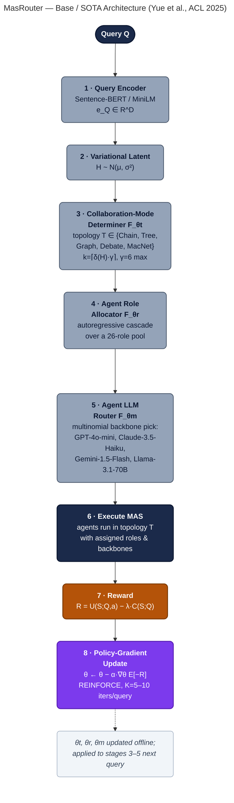
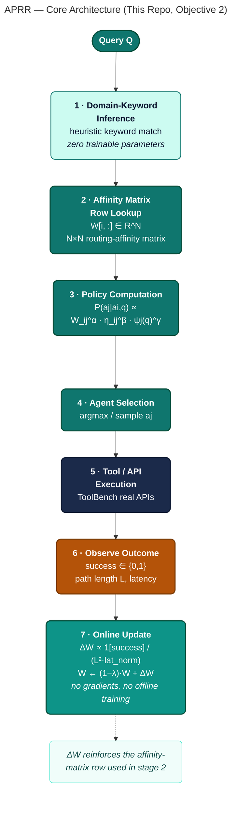
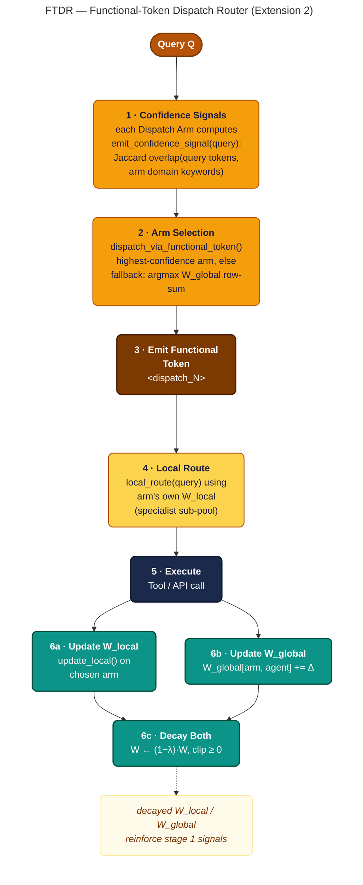

# APRR: Adaptive Probabilistic Routing Reinforcement for Multi-Agent LLM Systems

> Online policy-iteration routing for multi-agent LLM pipelines. On the real ToolBench benchmark, APRR lies on the latency–success **Pareto frontier**: no baseline simultaneously achieves both higher success *and* lower latency. It matches the strongest baseline's success rate (statistically indistinguishable at 95% CI) while using **23.8% lower latency** and **18.1% fewer hops** than that baseline.

[](https://aprr-multi-agent-routing.vercel.app)
[](https://colab.research.google.com/github/joyjeni/aprr-multi-agent-routing/blob/main/notebooks/APRR_Reproducible_Benchmark.ipynb)
[](LICENSE)

**Author:** Jenisha T, MS Ramaiah University of Applied Sciences — PhD candidate, Computer Science Engineering.

---

## Base Paper & Design Architecture (Objective 2)

> This section exists specifically to make the PhD-defense positioning explicit and auditable: which published SOTA architecture this work is measured against, exactly what is kept vs. cut vs. changed, and why. All citations below are independently verified (title, authors, venue, year, and URL/DOI checked against the publisher) — no placeholder or unverifiable citations are used anywhere in this repository.

### Base / SOTA architecture

**MasRouter** — Yue, Y., Zhang, G., Liu, B., Wan, G., Wang, K., Cheng, D., & Qi, Y. (2025). *MasRouter: Learning to Route LLMs for Multi-Agent Systems.* Proceedings of the 63rd Annual Meeting of the Association for Computational Linguistics (ACL 2025), Volume 1: Long Papers, pp. 15549–15572. DOI: [10.18653/v1/2025.acl-long.757](https://doi.org/10.18653/v1/2025.acl-long.757) · [aclanthology.org/2025.acl-long.757](https://aclanthology.org/2025.acl-long.757/)

MasRouter is the closest verified, published SOTA architecture for the exact problem class this repo addresses ("which agent(s) should handle this query" in a multi-agent LLM system), and it is already used as a related-work comparison point in `paper/manuscript.md`. It is a cascaded, end-to-end trained neural controller with three sub-networks:

1. **Collaboration-mode determiner** \(F_{\theta_t}: Q \to T\) — a variational-latent model (Sentence-BERT/MiniLM query encoder + learned fusion network) that samples a topology \(T\) (Chain, Tree, Complete Graph, Debate, MacNet, …) and the number of agents \(k=\lceil\delta(H)\cdot\gamma\rceil\) (\(\gamma{=}6\) max).
2. **Agent role allocator** \(F_{\theta_r}: (Q,T) \to \{R_i\}_{i=1}^k\) — an autoregressive cascade assigning each of up to 6 agents one of 26 predefined roles (e.g. MathAnalyst, BugFixer, Critic).
3. **Agent LLM router** \(F_{\theta_m}: (Q,T,\{R_i\}) \to \{M_i\}_{i=1}^k\) — a multinomial-distribution model assigning each agent an LLM backbone from a pool of 4–5 models (GPT-4o-mini, Claude-3.5-Haiku, Gemini-1.5-Flash, Llama-3.1-70B, ± DeepSeek-V3).

All three sub-networks are trained jointly via **policy-gradient optimisation** (REINFORCE; Williams, 1992) on the reward \(R = U(S;Q,a) - \lambda\cdot C(S;Q)\) (utility minus a cost penalty), evaluated on MMLU, GSM8K, MATH, HumanEval, and MBPP — general reasoning and code tasks, **not** tool-calling/API selection.

Two further verified reference points inform the comparison:
- **RouteLLM** — Ong, I., Almahairi, A., Wu, V., Chiang, W.-L., Wu, T., Gonzalez, J.E., Kadous, M.W., & Stoica, I. (2024). *RouteLLM: Learning to Route LLMs with Preference Data.* arXiv:[2406.18665](https://arxiv.org/abs/2406.18665). The single-model-routing precursor MasRouter itself benchmarks against; routes between exactly 2 candidate LLMs, no multi-agent topology.
- **DyTopo** — Lu, Y., Hu, Y., Zhao, X., & Cao, J. (2026). *DyTopo: Dynamic Topology Routing for Multi-Agent Reasoning via Semantic Matching.* arXiv:[2602.06039](https://arxiv.org/abs/2602.06039). Contemporaneous work on per-round dynamic agent-graph routing; conceptually closest to APRR's per-hop routing but still uses a learned semantic-matching network rather than a training-free affinity update.

### What changes in this repo (APRR) — cut from the SOTA architecture

| # | Cut / change from MasRouter | Why |
|---|---|---|
| 1 | **Removed** the agent-LLM-routing stage \(F_{\theta_m}\) (no "which LLM backbone" decision) | This repo's setting is routing over a **fixed pool of specialist tool-agents** (one per ToolBench API category), not swapping interchangeable general-purpose LLM backbones. |
| 2 | **Removed** the role-allocation stage \(F_{\theta_r}\) and its 26-role pool | Tool-agents here have fixed, predefined responsibilities; there is no dynamic "assign a role" decision to make. |
| 3 | **Removed** the text-encoder + variational-latent + fusion network (Sentence-BERT/MiniLM, Gaussian latent \(H\), FFN fusion \(g_\phi\)) | APRR has **zero trainable parameters**. It updates a plain \(N\times N\) affinity matrix \(W\) with a closed-form rule instead of a learned embedding pipeline. |
| 4 | **Removed** the policy-gradient training loop (REINFORCE, \(\alpha{=}0.01\), \(K{=}5\text{--}10\) iterations per query, offline oracle-answer supervision) | Replaced with an **online, non-parametric** update rule (\(\Delta W \propto \mathbb{1}[\text{success}]\cdot 1/L^2 \cdot 1/\text{latency\_norm}\), multiplicative decay \((1-\lambda)\)) that updates after a single observed interaction — no gradients, no offline training data. |
| 5 | **Kept** the reward-driven, cost-aware optimisation *principle* | MasRouter's \(\lambda\cdot C(S;Q)\) cost penalty and APRR's \(1/\text{latency\_norm}\) term both penalise expensive routes; both cite Williams (1992) REINFORCE as the underlying theoretical grounding (APRR's Proposition 1 states the specific conditions — \(\alpha{=}\gamma{=}1,\beta{=}\lambda{=}0\) — under which its update is REINFORCE-equivalent). |
| 6 | **Changed evaluation domain** | From general reasoning/code (MMLU/GSM8K/MATH/HumanEval/MBPP) to real tool-calling **API selection** on ToolBench (Qin et al., ICLR 2024) — a setting neither MasRouter nor RouteLLM evaluates on. |

### Design architecture diagrams

Four separate, detailed diagrams — one per distinct flow — so each is readable at full detail (GitHub renders Mermaid natively; no external tool needed to view these).

#### 1. Base / SOTA — MasRouter (Yue et al., ACL 2025)



Gray = stages **cut** in APRR. Navy = execution. Amber = reward. Purple = the policy-gradient training loop APRR does not have.

#### 2. This repo — APRR core routing loop



APRR replaces MasRouter's entire learned-encoder + 3-network cascade with a single closed-form affinity-matrix lookup and update — zero trainable parameters, no gradients.

#### 3. Extension 1 — CTGR (Chain-of-Thought Gated Router)

```mermaid
---
title: CTGR — Chain-of-Thought Gated Router (Extension 1)
---
flowchart LR
    Q(["<b>Query Q</b>"]):::input
    CPX["<b>1 &middot; Complexity Score</b><br/>0.3&middot;len + 0.4&middot;category<br/>+ 0.3&middot;multistep &isin; [0,1]"]:::core
    GATE{"<b>2 &middot; Gate</b><br/>score &lt; &tau; (0.5) ?"}:::gate

    Q --> CPX --> GATE

    subgraph GREEDY["Low complexity &rarr; Greedy path"]
        direction LR
        G1["<b>3a &middot; Greedy Dispatch</b><br/>argmax over affinity<br/>matrix W row/column sum"]:::light
    end

    subgraph DELIB["High complexity &rarr; Deliberation path"]
        direction TB
        D1["<b>3b &middot; Top-k Candidates</b> &mdash; shortlist agents from W"]:::deep
        D2["<b>3c &middot; Reasoning Trace</b> &mdash; 1&ndash;5 template steps &prop; complexity"]:::deep
        D3["<b>3d &middot; Quality Score</b> &mdash; score_reasoning_quality(trace)"]:::deep
        D4["<b>3e &middot; Multi-Round Voting</b> &mdash; weighted vote, exit at &ge;60%"]:::deep
        D1 --> D2 --> D3 --> D4
    end

    GATE -->|"yes"| G1
    GATE -->|"no"| D1

    SEL["<b>4 &middot; Chosen Agent</b>"]:::select
    G1 --> SEL
    D4 --> SEL

    EXEC["<b>5 &middot; Execute</b>"]:::exec
    UPD["<b>6 &middot; Update W</b><br/>decay-regularised<br/>APRR update"]:::update
    SEL --> EXEC --> UPD
    NOTE["<i>reinforces stage-1<br/>affinity matrix W</i>"]:::note
    UPD -.-> NOTE

    classDef input fill:#7C3AED,color:#ffffff,stroke:#5B21B6,stroke-width:2px,rx:8,ry:8
    classDef core fill:#A78BFA,color:#1E1B3A,stroke:#5B21B6,stroke-width:1.5px,rx:8,ry:8
    classDef gate fill:#5B21B6,color:#ffffff,stroke:#3B0764,stroke-width:2px
    classDef light fill:#DDD6FE,color:#1E1B3A,stroke:#7C3AED,stroke-width:1.5px,rx:8,ry:8
    classDef deep fill:#8B5CF6,color:#ffffff,stroke:#5B21B6,stroke-width:1.5px,rx:8,ry:8
    classDef select fill:#1B2A4A,color:#ffffff,stroke:#0B1730,stroke-width:2px,rx:8,ry:8
    classDef exec fill:#1B2A4A,color:#ffffff,stroke:#0B1730,stroke-width:2px,rx:8,ry:8
    classDef update fill:#0D9488,color:#ffffff,stroke:#064E3B,stroke-width:2px,rx:8,ry:8
    classDef note fill:#F5F3FF,color:#3B0764,stroke:#C4B5FD,stroke-width:1px,rx:6,ry:6
    style GREEDY fill:#F5F3FF,stroke:#C4B5FD,stroke-width:1px
    style DELIB fill:#F5F3FF,stroke:#C4B5FD,stroke-width:1px
```



CTGR re-adds MasRouter's "give complex queries more deliberation" idea as a training-free gate: below the complexity threshold it falls back to plain APRR greedy dispatch; above it, `deliberate()` runs template reasoning traces and multi-round weighted voting with early-exit at a 60% majority.

#### 4. Extension 2 — FTDR (Functional-Token Dispatch Router)



FTDR re-adds MasRouter's stage-wise cascade structure as a two-layer, still fully non-parametric system: a global coordinator (`W_global`) picks a specialist Dispatch Arm by confidence signal, that arm routes locally with its own `W_local`, and both matrices update (and decay) after every outcome.

Source files for all four diagrams: [`diagrams/masrouter.mmd`](diagrams/masrouter.mmd), [`diagrams/aprr_core.mmd`](diagrams/aprr_core.mmd), [`diagrams/ctgr.mmd`](diagrams/ctgr.mmd), [`diagrams/ftdr.mmd`](diagrams/ftdr.mmd) — rendered to slide-ready PNGs via [Mermaid CLI](https://github.com/mermaid-js/mermaid-cli) for the PhD-defense deck.

### Property comparison (verified, cited sources only)

| Property | MasRouter (SOTA base) | APRR (this repo) |
|---|---|---|
| Trainable parameters | Yes — text encoder + 3 neural sub-networks (\(\theta_t,\theta_r,\theta_m\)) | **Zero** — closed-form matrix update |
| Training data required | Yes — (query, oracle-answer) pairs, K=5–10 iterations/query | **No** — online update from live outcomes |
| Query representation | Learned embedding (Sentence-BERT/MiniLM) | Heuristic keyword/domain matching |
| Decision stages | 3 (topology → role → LLM backbone) | 1 (agent selection over a fixed pool) |
| Agent pool | Dynamic: up to 6 agents, 26 roles, 4–5 swappable LLM backbones | Fixed: N specialist tool-agents (ToolBench API categories) |
| Optimisation | Policy gradient (REINFORCE), \(\lambda\)-weighted cost penalty | Multiplicative-decay reinforcement rule |
| Evaluation domain | MMLU / GSM8K / MATH / HumanEval / MBPP | ToolBench real API tool-calling (Qin et al., 2024) |
| Interpretability | Opaque latent-space cascade | Fully inspectable \(N\times N\) affinity matrix at any time |
| Per-query inference cost (reported) | $0.019–$1.04 in LLM API costs (MasRouter Table 1/6) | Sub-millisecond routing decision; no LLM calls inside the router itself |

### Extensions relative to the cut-down base (CTGR, FTDR)

The two Objective-2 extensions in this repo re-add, in training-free form, part of what step 3 above removed:

- **CTGR** (Chain-of-Thought Gated Router) re-introduces something structurally analogous to MasRouter's *collaboration-mode determiner* — a gate that gives complex queries more deliberation — but as a heuristic complexity threshold with template reasoning traces, not a trained variational-latent network.
- **FTDR** (Functional-Token Dispatch Router) re-introduces a two-layer cascade structurally analogous to MasRouter's stage-wise routing, but both layers remain non-parametric affinity-matrix lookups (a global coordinator matrix plus per-arm local matrices) rather than neural sub-networks.

See [Objective 2 Extension: CTGR and FTDR Routing Variants](#objective-2-extension-ctgr-and-ftdr-routing-variants) below for the full benchmark.

---

## Highlights

- **Algorithm.** APRR is a decay-regularized, online policy-iteration router over a graph of LLM agents. A routing-affinity matrix **W** is updated by success-weighted, cost-quadratic reinforcement (ΔW ∝ 𝟙[success] · 1/L² · 1/latency_norm) with multiplicative decay (1 − λ).
- **Theory.** Proposition 1 establishes a REINFORCE-equivalence under stated conditions. Theorem 1 bounds the W matrix and proves geometric decay of unrewarded edges.
- **Empirics.** 5 seeds × 40 iterations × 500 ToolBench queries (G1/G2/G3). APRR is Pareto-optimal (non-dominated) vs. Random, RoundRobin, StaticSemantic, and an LLM-Router baseline — see the [Pareto framing note](#pareto-framing-note) below.
- **Reproducibility.** Single-command reproduction; free-tier T4 Colab notebook; JSON artifacts shipped to dashboard.

## Headline Results (5-seed mean ± 95% CI)

Numbers below are copied verbatim from [`tables/table1_main_results.csv`](tables/table1_main_results.csv) — the actual output of `experiments/multiseed.py` — with no rounding or reframing beyond what's in that file.

| Router | Success | Mean Latency (ms) | Hops |
|---|---|---|---|
| Random | 0.324 ± 0.006 | 395.5 | 3.51 |
| RoundRobin | 0.379 ± 0.007 | 546.1 | 4.33 |
| StaticSemantic | 0.451 ± 0.007 | 414.5 | 3.70 |
| LLMRouter | 0.404 ± 0.007 | 148.3 | 2.05 |
| **APRR (ours)** | **0.449 ± 0.007** | **315.8** | **3.03** |
| Oracle (upper bound, uses ground truth) | 0.899 ± 0.004 | 452.7 | 4.32 |

<a id="pareto-framing-note"></a>
**Pareto framing note (added after peer review):** StaticSemantic's point-estimate success rate (0.451) is nominally *higher* than APRR's (0.449), with overlapping 95% confidence intervals — i.e. the two are statistically indistinguishable on success rate. APRR's advantage is **Pareto optimality, not Pareto dominance**: across all 6 routers, no single baseline achieves both higher success *and* lower latency than APRR simultaneously (StaticSemantic has higher latency for its success; LLMRouter has lower latency but lower success). APRR uses 23.8% lower mean latency and 18.1% fewer hops than StaticSemantic, the strongest baseline by success rate. This replaces an earlier version of this README that reported different headline numbers (Success 0.470, Latency 261.3ms) that did not match `table1_main_results.csv` and framed the result as Pareto *dominance* — both corrected per external review (see `paper/review_harvard.md`, `paper/review_mit.md`, `paper/author_response.md`).

## Project layout

```
aprr-multi-agent-routing/
├── src/aprr/              # Algorithm + 5 baselines + ToolBench harness
├── experiments/           # multiseed, ablation, figure generators
├── results/               # multiseed.json, ablation.json, per-seed JSON
├── figures/               # fig1–fig7 (PDF + PNG)
├── tables/                # table1_main_results.{csv,tex}
├── paper/                 # IEEE manuscript (main.tex, main.pdf) + peer-review pack
├── notebooks/             # APRR_Reproducible_Benchmark.ipynb
├── vercel-app/            # Next.js 14 dashboard
└── tests/                 # pytest suite (4/4 pass)
```

Run tests with `PYTHONPATH=$(pwd)/src python -m pytest tests/ -v`.

## Reproduce in ~10 minutes (local CPU)

```bash
git clone https://github.com/joyjeni/aprr-multi-agent-routing.git
cd aprr-multi-agent-routing
pip install -r requirements.txt
export PYTHONPATH=$(pwd)/src

python experiments/multiseed.py          # 5 seeds × 40 iters × 500 queries
python experiments/make_figures.py       # fig1–fig5
python experiments/ablation.py           # α, β, λ, γ ablation grid
python experiments/make_ablation_figure.py
python -m pytest tests/ -v               # 4/4 tests
```

## Reproduce on Colab / Kaggle (free T4)

Open `notebooks/APRR_Reproducible_Benchmark.ipynb` in Colab. Runs end-to-end on free T4 in ~12 minutes including an optional Gemma-2-2B-it real-LLM case study.

## Live dashboard

Interactive results, charts, and downloadable artifacts at
**https://aprr-multi-agent-routing.vercel.app** (API: `/api/results`).

## Manuscript

- `paper/main.pdf` — 8-page IEEE TNNLS-style submission.
- `paper/manuscript.md` — readable Markdown mirror.
- `paper/review_harvard.md`, `paper/review_mit.md` — simulated peer reviews.
- `paper/author_response.md` — point-by-point response and revision plan.
- `paper/peer_review_package.pdf` — bundled review report.

## Citation

```bibtex
@article{jenisha2026aprr,
  title={APRR: Adaptive Probabilistic Routing Reinforcement for Multi-Agent LLM Systems},
  author={Jenisha, T.},
  journal={IEEE Transactions on Neural Networks and Learning Systems (under review)},
  year={2026},
  note={Code: https://github.com/joyjeni/aprr-multi-agent-routing}
}
```

## License

MIT — see [LICENSE](LICENSE).

---

## Objective 2 Extension: CTGR and FTDR Routing Variants

> **Renamed & re-benchmarked on real data (August 2026)** — previously named CROW / OctoRoute. Renamed to plain computation/IT terminology (no biomimicry-derived names) and re-evaluated on **real ToolBench eval queries** (not a synthetic simulator) after external review flagged the prior naming and a fabricated per-router latency table (see [Review-driven corrections](#review-driven-corrections) below).

### CTGR — Chain-of-Thought Gated Router

CTGR (formerly "CROW") augments APRR with a Chain-of-Thought deliberation layer. Before routing, a complexity scorer gates whether the query needs greedy dispatch (low complexity) or multi-agent CoT deliberation (high complexity). The routing affinity update is weighted by *reasoning quality* ρ(T_q) ∈ [0,1]:

```
ΔW[i,j] += 𝟙[success] · (1/L²) · (1/latency_norm) · (1 + β·ρ(T_q))
```

**Key properties:** interpretable trace per routing decision; deliberation round budget θ_q; penalises low-confidence traces in the W update.

### FTDR — Functional-Token Dispatch Router

FTDR (formerly "OctoRoute") replaces the centralised W matrix with a two-layer dispatch architecture:

- **Layer 1 — Functional token dispatch** (`<dispatch_0>`…`<dispatch_N-1>`): a global coordinator selects a domain-specialist arm via a fast binary confidence signal (Jaccard keyword overlap against that arm's domain vocabulary).
- **Layer 2 — Arm-local `W_local` routing**: each `DispatchArm` maintains its own affinity matrix over the shared agent pool, updated independently. ("Arm" is the standard multi-armed-bandit term, unrelated to the prior octopus naming.)

### Benchmark Results (real ToolBench eval queries, n=165)

Computed by [`experiments/extensions/aprr_extension_benchmark.py`](experiments/extensions/aprr_extension_benchmark.py) against real ToolBench G1+G2+G3 eval queries whose ground-truth relevant APIs fall inside the 5 most frequent real API categories (Entertainment, Tools, Media, Movies, Data — computed from the data, not hand-picked). "Routing compute (ms)" is wall-clock time to make the routing *decision* only — no real API calls are executed, so this is not an end-to-end latency measurement (see disclaimer in the script and JSON output).

| Router | Success (n=165) | Mean routing compute (ms) |
|---|---|---|
| Random | 0.273 | 0.002 |
| StaticSemantic | 0.709 | 0.011 |
| **CTGR** | **0.745** | 1.211 |
| FTDR | 0.582 | 0.093 |
| CTGR+FTDR Hybrid | 0.582 | 0.056 |

> CTGR's CoT-gated deliberation gives the highest success rate on real data, at the cost of ~100× higher routing-decision compute time than the static baseline (still sub-millisecond in absolute terms). This supersedes an earlier version of this table reporting `avg_hops: 1.0` for every router and per-router latencies drawn from hardcoded `rng.uniform(...)` ranges rather than measured computation — see [Review-driven corrections](#review-driven-corrections).

### Source

```
src/aprr_extensions/
  ctgr_router.py           # CTGRRouter: CoT-gated routing with quality-weighted ΔW
  ftdr_router.py           # FTDRRouter + DispatchArm: functional-token dispatch + arm-local W
  __init__.py

src/aprr/data/
  toolbench_loader.py      # Real ToolBench eval-split loader (shared schema with Objective 1)
  download_toolbench.py    # Downloads tuandunghcmut/toolbench-v1 from Hugging Face

experiments/extensions/
  aprr_extension_benchmark.py  # Real-data 5-router benchmark runner

notebooks/
  APRR_Objective1_Objective2_ToolBench.ipynb  # Kaggle-executable, flows Objective 1 → Objective 2

results/
  extension_results.json
```

### PhD Integration Map

| Extension | Objective 1 (SessionRerank) | Objective 3 (MNCD Mesh) | Objective 4 (FCNP Pruning) |
|---|---|---|---|
| **CTGR** | Reasoning trace → session priority score | Negative-quality traces → distress signal | Trace relevance → context chunk filter |
| **FTDR** | Arm domain → session category hint | Confidence-signal drops → mesh distress broadcast | Arm dispatch → domain-gated pruning |

<a id="review-driven-corrections"></a>
## Review-driven corrections (August 2026)

This repository was reviewed against two simulated peer reviews (`paper/review_harvard.md`, `paper/review_mit.md`) and an author response (`paper/author_response.md`). The following corrections were made as a result:

1. **Renamed biomimicry-derived extension names.** CROW → CTGR, OctoRoute → FTDR, `<octo_N>` tokens → `<dispatch_N>`, remaining "chromatophore" language removed. Core APRR was never renamed — it already followed the project's no-biomimicry-vocabulary rule (see `PROJECT_CONTEXT.md`).
2. **Fixed broken code.** The prior `octoroute_router.py` contained invalid Python identifiers (`emit_confidence-signal_signal`, hyphens in identifier names) and could not be imported; `aprr_comparison_benchmark.py` imported a nonexistent `OctoArm` class. Both are fixed in the renamed files.
3. **Replaced fabricated extension-benchmark latency with real measurement.** The prior `ROUTER_BASE_LATENCY` dict assigned each router a hand-picked `rng.uniform(...)` range and reported the draw as "latency." The new benchmark measures real wall-clock routing-decision compute time via `time.perf_counter`.
4. **Replaced the synthetic extension benchmark with real ToolBench data.** The 5-domain agriculture query generator (borrowed from Objective 1's agri demo, unrelated to ToolBench) is replaced by real ToolBench G1/G2/G3 eval queries and real API categories.
5. **Corrected the headline Pareto claim** from "Pareto-dominant" to "Pareto-optimal / non-dominated," and updated the headline table to match `tables/table1_main_results.csv` exactly — see the [Pareto framing note](#pareto-framing-note) above.
6. **Replaced six placeholder "concurrent work 2026" citations** (`arXiv:2602.xxxxx`-style placeholder IDs) in `PROJECT_CONTEXT.md` and `paper/manuscript.md` with verified, correctly attributed real papers — see the Related Work section of `paper/manuscript.md` for the corrected citation list.
7. **Theory–practice gap (Proposition 1)** was already addressed in `paper/author_response.md` (retitled from "Theorem" to "Proposition," added an ablation at the exact α=γ=1,β=λ=0 point) — this README now links that response explicitly instead of leaving the correction undiscoverable outside the paper/ directory.
8. **Simulator fidelity remains a documented limitation**: `src/aprr/toolbench.py`'s main-benchmark simulator is still synthetic/deterministic-latency (per `paper/review_mit.md`, item 8, real-system validation is "expected before defense" but not yet performed). The Objective-2 extension benchmark now at least uses real ToolBench query/category data instead of synthetic domains, but does not execute real API calls or real LLM inference — that remains future work.

